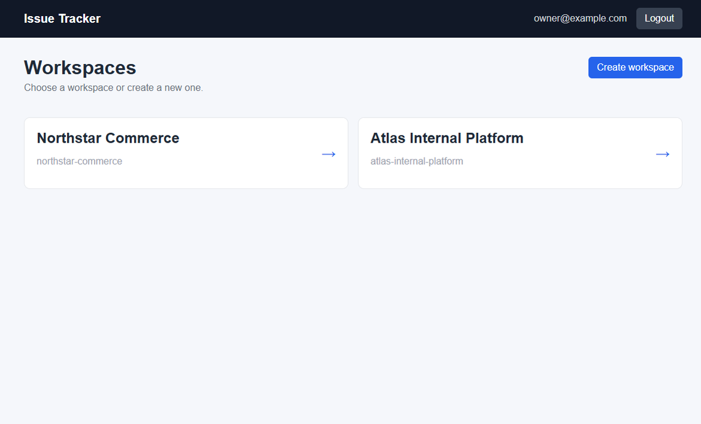
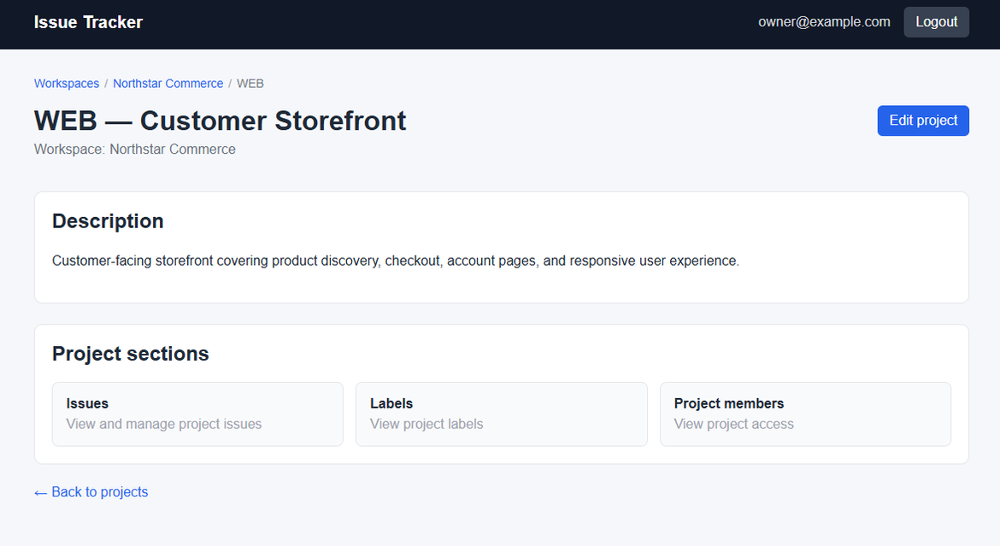
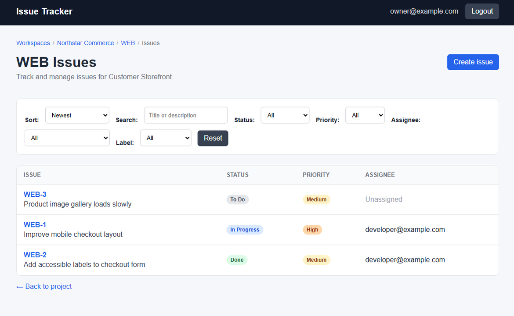
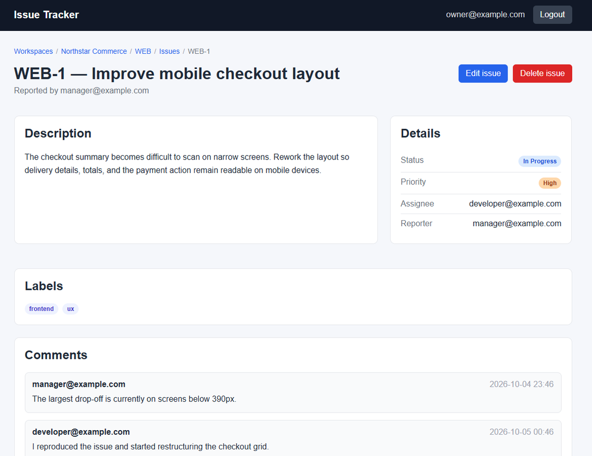
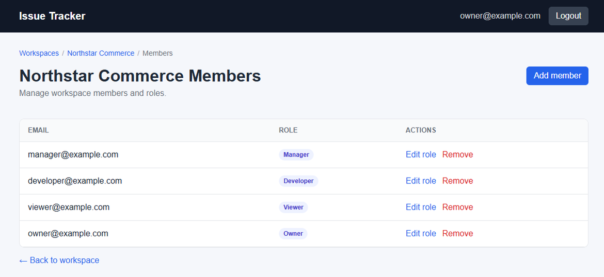

# Django Issue Tracker

A portfolio issue tracking application built with Django.

The project demonstrates a practical multi-workspace issue tracking system with role-based permissions, project-level access, issue workflows, comments, activity history, filtering, search, Docker, PostgreSQL, automated tests, CI, and social authentication.

## Live Demo

The application is deployed and available online.

**[🌐 Open Live Demo](https://issuetracker.eugene-dev-hub.space/)**

> Demo accounts and login credentials are available on the [portfolio website](https://eugene-dev-hub.space/).

## Key Features

- Email/password registration and login
- Google and GitHub OAuth login
- Password reset
- Multiple Workspaces
- Workspace roles: Owner, Manager, Developer, Viewer
- Project-level access for Developers and Viewers
- Issues with statuses and priorities
- Assignees, labels, comments, and activity history
- Filtering, search, and sorting
- PostgreSQL
- Docker / Docker Compose
- GitHub Actions CI
- Production-oriented configuration

## Screenshots

### Workspace overview



### Project page



### Issue list



### Issue details



### Member management



## Demo Accounts

After running the demo seed command:

```text
owner@example.com
manager@example.com
developer@example.com
viewer@example.com
```

Password for all demo accounts:

```text
test12345
```

Create the demo data with:

```bash
docker compose exec web python manage.py seed_demo
```

## Quick Start

Copy the example environment file:

```powershell
Copy-Item .env.example .env
```

Build and start the project:

```powershell
docker compose up --build
```

Apply migrations:

```powershell
docker compose exec web python manage.py migrate
```

Create demo data:

```powershell
docker compose exec web python manage.py seed_demo
```

Open:

```text
http://localhost:8000
```

For full installation instructions, authentication setup, permissions, project structure, testing, demo data, and production notes, see:

[Project Guide](docs/PROJECT_GUIDE.md)

## License

This project is intended to be distributed under the MIT License.

See the [`LICENSE`](LICENSE) file for the full license text.
